# SDLC — Kids Activity App

> Cycle de vie du développement logiciel (*Software Development Life Cycle*) du projet **kids-app** :
> de l'idée jusqu'à la production, qui fait quoi, avec quels outils et quelles règles.
>
> Documents de référence (en cas de conflit, cet ordre fait foi) :
> 1. [`.specify/memory/constitution.md`](../.specify/memory/constitution.md) — les principes non négociables
> 2. [`CLAUDE.md`](../CLAUDE.md) — conventions quotidiennes + contrat de handoff multi-agents
> 3. ce document — la vue d'ensemble et le mode d'emploi

---

## Sommaire

1. [Vue d'ensemble](#1-vue-densemble)
   - [1.1 Parcours complet, commande par commande](#11-parcours-complet-commande-par-commande)
2. [Acteurs et outils](#2-acteurs-et-outils)
3. [Architecture cible](#3-architecture-cible)
4. [Phase 0 — Gouvernance](#4-phase-0--gouvernance)
5. [Phase 1 — Idée et cadrage](#5-phase-1--idée-et-cadrage)
6. [Phase 2 — User Story](#6-phase-2--user-story)
7. [Phase 3 — Développement](#7-phase-3--développement)
8. [Phase 4 — Code review](#8-phase-4--code-review)
9. [Phase 5 — QA](#9-phase-5--qa)
10. [Phase 6 — Merge et déploiement](#10-phase-6--merge-et-déploiement)
11. [Phase 7 — Exploitation et données](#11-phase-7--exploitation-et-données)
12. [Machine à états du board](#12-machine-à-états-du-board)
13. [Stratégie Git](#13-stratégie-git)
14. [Portes de qualité](#14-portes-de-qualité)
15. [Incidents et hotfix](#15-incidents-et-hotfix)
16. [Aide-mémoire des commandes](#16-aide-mémoire-des-commandes)
17. [Limites connues et évolutions](#17-limites-connues-et-évolutions)

---

## 1. Vue d'ensemble

Le projet suit un cycle **itératif et incrémental** : une User Story à la fois, livrée en continu
sur `main` (= production Vercel). Chaque étape est tenue par un rôle distinct et séparée de la
suivante par une **porte de qualité**.

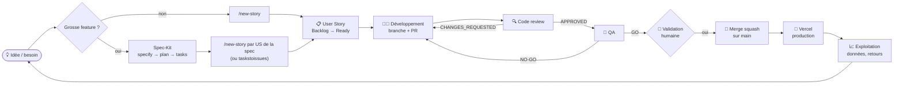

| Phase | Sortie attendue | Responsable | Porte de sortie |
|---|---|---|---|
| 0. Gouvernance | Constitution + CLAUDE.md | Humain | PR dédiée d'amendement |
| 1. Cadrage | `specs/<NNN>-*/spec.md`, `plan.md`, `tasks.md` | Humain + Spec-Kit | Gate « approve » à chaque étape |
| 2. User Story | Issue `[US]` avec Gherkin | `product-owner` | Checklist INVEST → `status: ready` |
| 3. Développement | Branche + PR `Closes #N` | `developer` | lint + type-check + build verts |
| 4. Review | Commentaire `VERDICT: *` | `reviewer` | `VERDICT: APPROVED` |
| 5. QA | Tableau de preuves sur l'issue | `qa` | `QA: GO` + CI verte |
| 6. Merge | Commit squash sur `main` | **Humain** | Accord explicite |
| 7. Exploitation | Prod Vercel, données Supabase | Humain | Vérification prod |

### 1.1 Parcours complet, commande par commande

De l'idée que tu as en tête jusqu'à la feature en production. **Où** indique où taper la commande :
💬 = dans Claude Code (chat), 🖥️ = dans le terminal.

`<num>` = numéro de l'issue · `<pr>` = numéro de la PR · `<item-id>` = id de la carte dans le Project.

| # | Étape | Où | Commande | Résultat attendu / à vérifier |
|---|---|---|---|---|
| **0** | **Partir d'une base propre** | 🖥️ | `git switch main && git pull` | `main` à jour, `git status` sans changement en cours |
| 0b | Vérifier que tout est vert avant de commencer | 🖥️ | `npm run lint && npm run type-check && npm run build` | 3 commandes vertes |
| **1** | **Choisir le chemin** | — | Petite idée (1 écran, ≤ 2 US) → étape 2 · grosse feature (plusieurs écrans, schéma de données) → étape 1a ([détail 1a–1g](#instructions--chemin-spec-kit-étapes-1a-à-1g)) | — |
| 1a | Rédiger la spec | 💬 | `/speckit-specify <description de l'idée en langage naturel>` | `specs/<NNN>-<slug>/spec.md` créé |
| 1b | Lever les ambiguïtés (si besoin) | 💬 | `/speckit-clarify` | Au plus 5 questions, réponses intégrées à la spec |
| 1c | ✋ **Relire la spec** | — | Ouvrir `specs/<NNN>-<slug>/spec.md` | Tu valides avant de continuer |
| 1d | Plan technique | 💬 | `/speckit-plan` | `plan.md` conforme à la constitution |
| 1e | Découper en tâches | 💬 | `/speckit-tasks` | `tasks.md` ordonné par dépendances |
| 1f | Contrôle de cohérence | 💬 | `/speckit-analyze` | Rapport sans incohérence bloquante |
| 1g | Créer les issues | 💬 | Recommandé : `/new-story US1 de specs/<NNN>-<slug>/spec.md` (une fois par US) · ou `/speckit-taskstoissues` (une issue par tâche, hors board) | Issues au format du pipeline → passer à l'étape 3 |
| **2** | **Créer la User Story** (petite idée) | 💬 | `/new-story <ton besoin en une ou deux phrases>` | Issue `[US] …` avec critères Gherkin, labels, carte en Backlog |
| **3** | **Relire l'US** | 🖥️ | `gh issue view <num>` | Critères observables, checklist INVEST cochée |
| 3b | Vérifier qu'elle est prête | 🖥️ | `gh issue list --label "status: ready"` | L'issue apparaît (sinon : demander au PO de l'affiner) |
| **4** | **Développer** | 💬 | `/pick-next <num>` | Branche `feat/<num>-slug`, PR ouverte avec `Closes #<num>`, label `status: review` |
| 4b | Retrouver la PR | 🖥️ | `gh pr list --head feat/<num>-slug` | Numéro `<pr>` |
| 4c | Tester toi-même (optionnel) | 🖥️ | `gh pr checkout <pr> && npm run dev` | Feature visible sur http://localhost:3000 |
| **5** | **Code review** | 💬 | `/review-pr <pr>` | Review postée, dernière ligne `VERDICT: …` |
| 5b | Si `CHANGES_REQUESTED` | 💬 | « Utilise le sous-agent developer pour corriger la PR #&lt;pr&gt; selon la review » puis `/review-pr <pr>` | Max **2 allers-retours**, ensuite c'est toi qui tranches |
| **6** | **QA** (pas de slash command dédiée) | 💬 | « Utilise le sous-agent qa sur la PR #&lt;pr&gt; » | Tableau de preuves sur l'issue + `QA: GO` (ou `NO-GO` → retour étape 5b) |
| 6b | Vérifier la CI | 🖥️ | `gh pr checks <pr>` | `test` et Vercel au vert |
| 6c | Voir la preview Vercel | 🖥️ | `gh pr view <pr> --web` | Lien « Preview » dans les commentaires Vercel |
| **7** | ✋ **Ta décision de merge** | — | Relire verdict + QA + CI | Tu donnes ton accord explicite |
| 7b | Merger | 🖥️ | `gh pr merge <pr> --squash --delete-branch` | Commit `feat: … (#<pr>)` sur `main`, issue fermée, branche supprimée |
| **8** | **Déplacer la carte en Deployed** | 🖥️ | `gh project item-list 1 --owner mehdisebei-debug --format json` puis `gh project item-edit --id <item-id> --project-id PVT_kwHOEgSBb84BfnM_ --field-id PVTSSF_lAHOEgSBb84BfnM_zhZ43jw --single-select-option-id 4cf0d3db` | Carte dans la colonne Deployed |
| **9** | **Vérifier la production** | 🖥️ | `gh api repos/mehdisebei-debug/KIDS-APP/commits/main/status --jq .state` (statut Vercel) et `gh run list --branch main --limit 1` (job CI `test`), puis ouvrir l'URL Vercel | `success` + run `completed success`, feature visible en prod |
| 9b | Remettre le local à jour | 🖥️ | `git switch main && git pull` | Prêt pour l'idée suivante → retour étape 0 |

> **Raccourci** : les étapes 4 à 6 peuvent s'enchaîner d'un coup avec 💬 `/run-sprint <num>`
> (dev → review → QA, avec la limite de 2 boucles). Il **s'arrête toujours avant le merge** et attend
> ta décision (étape 7, toujours humaine). Après ton accord explicite, `/run-sprint` exécute lui-même
> les étapes 7b à 9 (merge squash, carte Deployed, vérification Vercel) ; sans `/run-sprint`, tu les
> fais toi-même avec les commandes ci-dessus.
>
> **Raccourci idée → US** : `/new-story` suffit pour la plupart des idées ; Spec-Kit (1a–1g) sert quand
> l'idée touche le schéma de données ou plusieurs écrans.

---

## 2. Acteurs et outils

### 2.1 Rôles

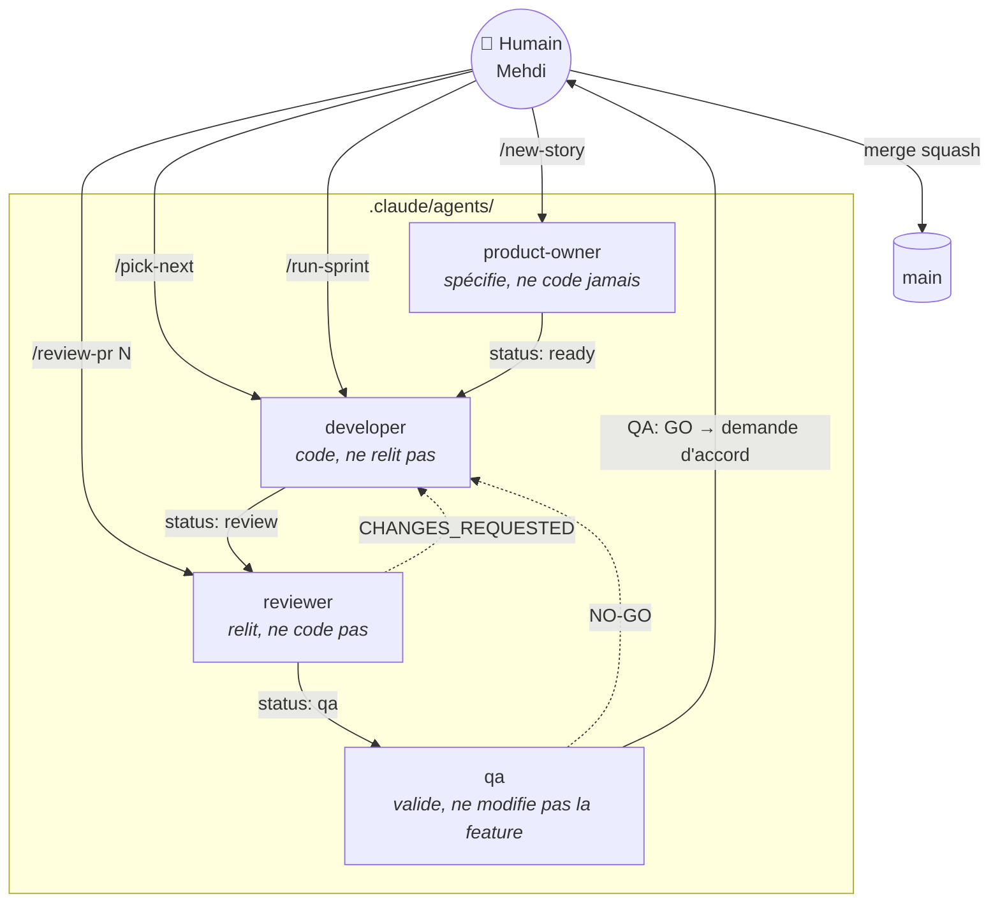

| Acteur | Fichier de définition | Skill chargée | Peut | Ne peut pas |
|---|---|---|---|---|
| Humain | — | — | Tout décider, **seul à autoriser un merge** | — |
| `product-owner` | `.claude/agents/product-owner.md` | `writing-user-stories` | Créer/affiner des issues | Coder |
| `developer` | `.claude/agents/developer.md` | `feature-development` | Brancher, coder, ouvrir une PR | Merger, relire son code |
| `reviewer` | `.claude/agents/reviewer.md` | `code-review` | Commenter la PR, poser un verdict | Modifier le code |
| `qa` | `.claude/agents/qa.md` | `testing` | Tester, écrire des tests, `QA: GO/NO-GO` | Modifier la feature, merger seul |

### 2.2 Outils

| Besoin | Outil |
|---|---|
| Code | Next.js 14 (App Router) · TypeScript · Tailwind CSS |
| Données | Supabase (PostgreSQL + PostGIS, RLS, Auth) |
| Carte | Mapbox GL JS via `react-map-gl` |
| Suivi | GitHub Issues + Project **KIDS-APP Pipeline** (n° 1) |
| Spécification | GitHub Spec-Kit (`.specify/`, skills `speckit-*`) |
| CI | GitHub Actions (`.github/workflows/ci.yml`, job `test`) |
| Protection | Ruleset GitHub `protect-main` (PR obligatoire, squash, check `test` requis) |
| Hébergement | Vercel (`main` = production automatique) |
| Agents | Claude Code (sous-agents, slash commands, hooks) |

---

## 3. Architecture cible

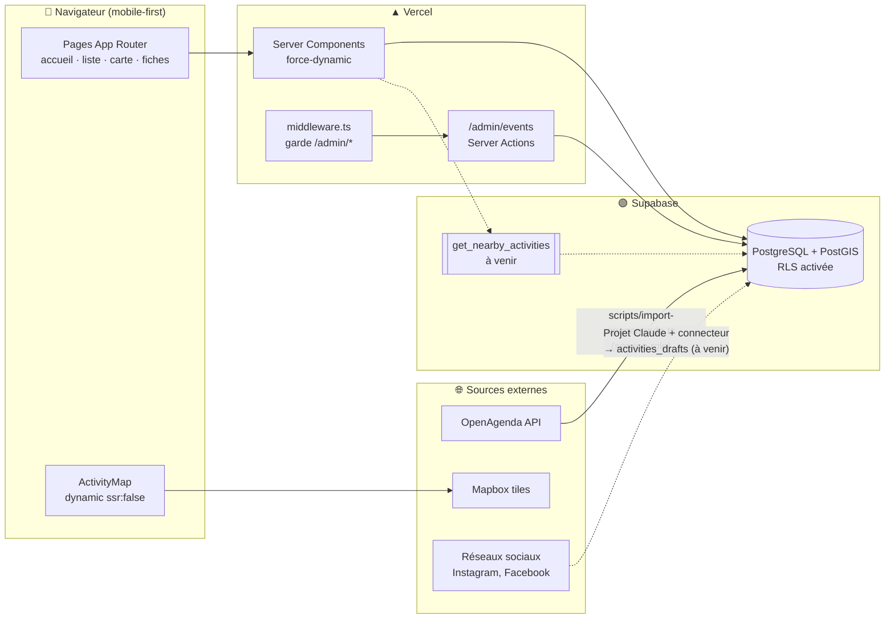

> Traits pointillés = cible pas encore implémentée sur `main` (RPC géospatiale, ingestion réseaux).

Règles d'architecture qui découlent de la constitution :

- **Secrets** : `SUPABASE_SERVICE_ROLE_KEY` uniquement dans `scripts/` et le code serveur, jamais dans
  un composant client. Tout est dans `.env.local` (local) et les variables d'environnement Vercel (prod).
- **Âges** : stockés en **mois** en base, convertis en années uniquement à l'affichage.
- **Carte** : toujours `dynamic(() => import(...), { ssr: false })` (Mapbox utilise `window`).
- **États** : tout composant qui fetch gère `loading`, `error`, `empty`.

---

## 4. Phase 0 — Gouvernance

La gouvernance définit les règles du jeu **avant** d'écrire du code.

| Document | Rôle | Comment le modifier |
|---|---|---|
| `constitution.md` | 5 principes (mobile-first, âge en mois, états explicites, typage strict, secrets) | PR dédiée + bump de version sémantique (skill `speckit-constitution`) |
| `CLAUDE.md` | Conventions, stack, contrat de handoff, IDs du Project | PR `chore:` |
| `.claude/agents/*.md` | Périmètre de chaque agent | PR `chore:` |
| `.claude/skills/*/SKILL.md` | Méthode détaillée de chaque rôle | PR `chore:` |
| `.claude/settings.json` | Hooks automatiques (type-check après chaque édition, lint + type-check en fin de tour) | PR `chore:` |

**Versionnage de la constitution :**

| Bump | Quand |
|---|---|
| MAJOR | Retrait ou redéfinition incompatible d'un principe |
| MINOR | Ajout d'un principe/section (ex. : arrivée de Vitest) |
| PATCH | Reformulation sans effet sémantique |

> ⚠️ Un amendement ne se glisse **jamais** dans une PR de fonctionnalité.

---

## 5. Phase 1 — Idée et cadrage

Deux chemins selon la taille du besoin :

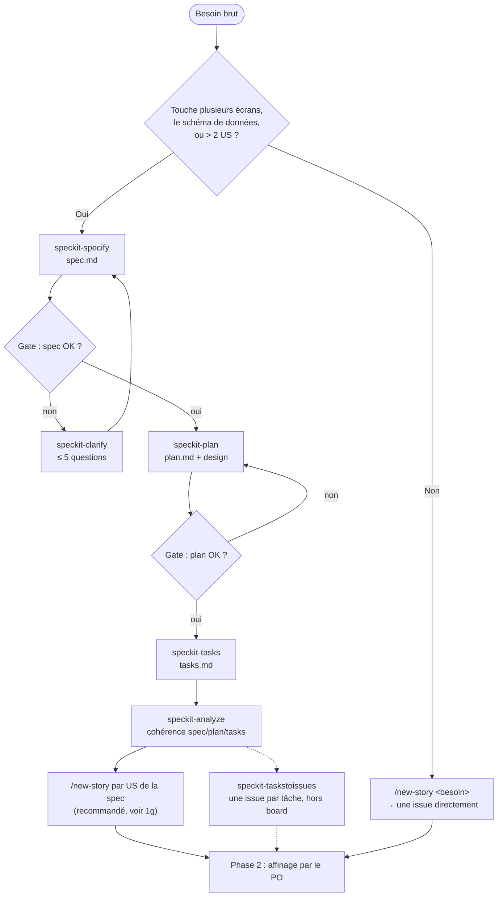

### Instructions — chemin Spec-Kit (étapes 1a à 1g)

Spec-Kit applique le *Spec-Driven Development* : on écrit **quoi** construire (spec), puis **comment**
(plan), puis **dans quel ordre** (tâches), chaque document étant confronté à la constitution.

| Étape | Commande | Lit | Produit | Modifie des fichiers ? |
|---|---|---|---|---|
| 1a | `/speckit-specify <idée>` | constitution | `specs/<NNN>-<slug>/spec.md`, `checklists/requirements.md`, `.specify/feature.json` | Oui |
| 1b | `/speckit-clarify` | `spec.md` | Section *Clarifications* dans `spec.md` | Oui (spec) |
| 1c | ✋ relecture humaine | `spec.md` | Ta validation | — |
| 1d | `/speckit-plan` | `spec.md`, constitution | `plan.md`, `research.md`, `data-model.md`, `quickstart.md`, et `contracts/` si interfaces externes | Oui |
| 1e | `/speckit-tasks` | `plan.md`, `spec.md`, design | `tasks.md` | Oui |
| 1f | `/speckit-analyze` | spec + plan + tasks | Rapport de cohérence | **Non** (lecture seule) |
| 1g | `/speckit-taskstoissues` | `tasks.md` | Issues GitHub | Oui (GitHub) |

#### 1a — `/speckit-specify <ton idée>`

**Toi :** décris l'idée en langage naturel, côté utilisateur, sans technique. Exemple :
`/speckit-specify Les parents peuvent enregistrer le profil de leur enfant (date de naissance) pour que la liste soit filtrée automatiquement sur son âge`.

**Claude :**
- donne un nom court à la feature et crée `specs/<NNN>-<slug>/` (numérotation séquentielle : 002, 003…) ;
- remplit `spec.md` : User Stories priorisées (P1, P2…) testables indépendamment, scénarios
  *Given / When / Then*, exigences fonctionnelles, critères de succès mesurables, cas limites ;
- génère `checklists/requirements.md` et s'auto-vérifie avec ;
- pose au plus **3** marqueurs `[NEEDS CLARIFICATION]` sur les décisions critiques et te propose des options ;
- enregistre la feature active dans `.specify/feature.json` (utilisée par les commandes suivantes).

> **Aucune branche Git n'est créée** dans ce projet : la création de branche est déléguée au hook
> `before_specify` de l'extension git de Spec-Kit, déclaré dans `.specify/extensions.yml`, et ce
> fichier n'existe pas ici. Les fichiers de spec restent donc non versionnés sur la branche courante
> jusqu'à ce que tu les commites avec la feature. (`here: true` dans `.specify/init-options.json`
> indique seulement que Spec-Kit a été initialisé dans le dossier courant.)

#### 1b — `/speckit-clarify` (facultatif, conseillé)

**Claude :** passe la spec au crible par catégorie (périmètre, données, parcours, erreurs,
non-fonctionnel…), note chacune *Clear / Partial / Missing*, puis pose **au plus 5 questions**, une
à la fois, avec une réponse recommandée.

**Toi :** réponds. Chaque réponse est écrite directement dans `spec.md` (section *Clarifications*).

À faire **avant** 1d ; ne se saute que pour un prototype jetable.

#### 1c — ✋ Relecture humaine (porte de validation)

Ouvre `spec.md` et vérifie :

- [ ] ça décrit ce que tu veux, et rien de plus ;
- [ ] les âges sont pensés pour être stockés **en mois** (principe II) ;
- [ ] chaque critère est observable dans l'UI ;
- [ ] plus aucun `[NEEDS CLARIFICATION]`.

Sinon : corrige à la main ou relance 1a / 1b.

#### 1d — `/speckit-plan`

**Claude :** passe au *comment* :
- `plan.md` : contexte technique, section **Constitution Check** (un écart non justifié = erreur
  bloquante), structure des fichiers ;
- `research.md` : résout les inconnues techniques et documente les choix ;
- `data-model.md` : entités, champs, relations (ex. `birth_date`, jamais d'âge stocké) ;
- `contracts/` : interfaces (requêtes Supabase, Server Actions…), **seulement** si la feature expose
  ou consomme des interfaces externes ;
- `quickstart.md` : scénarios de test manuels ;
- refait le Constitution Check une fois le design terminé.

**Toi :** vérifie l'absence de librairie non demandée, le respect de l'arborescence, `dynamic()` pour
la carte, etc.

#### 1e — `/speckit-tasks`

**Claude :** génère `tasks.md`, une checklist ordonnée par dépendances :

| Phase | Contenu |
|---|---|
| 1 | Setup |
| 2 | Fondations bloquantes (ex. table SQL) |
| 3+ | Une phase **par User Story**, par ordre de priorité |
| Finale | Finitions transverses |

Chaque tâche a un ID (`T001`…), un chemin de fichier précis, et `[P]` si elle est parallélisable.
Stratégie « MVP d'abord » : la P1 seule doit déjà livrer de la valeur.

#### 1f — `/speckit-analyze`

**Claude :** audit **en lecture seule** de spec + plan + tasks. Il repère : exigences sans tâche (et
inversement), doublons, ambiguïtés, terminologie incohérente, et **conflits avec la constitution**
(toujours classés CRITICAL). Il rend un rapport par sévérité et propose un plan de correction, appliqué
seulement avec ton accord.

**Règle :** aucun CRITICAL restant avant 1g.

#### 1g — `/speckit-taskstoissues`

**Claude :** crée **une issue GitHub par tâche** de `tasks.md`, dans l'ordre des dépendances, en
sautant celles qui existent déjà (dédoublonnage par ID `T001`…).

> ⚠️ **Attention, ça ne s'emboîte pas tel quel avec le pipeline :**
> 1. une issue **par tâche** (souvent 10 à 30), alors que le pipeline attend *une US = une issue* ;
> 2. ces issues n'ont **pas** les labels `type: user-story` / `priority: *` / `status: ready` et ne sont
>    **pas** sur le board : `/pick-next` ne les verra pas ;
> 3. la skill passe par le **serveur MCP GitHub**, pas par `gh` : sans ce connecteur, elle échoue.
>
> **Recommandé :** à la place de 1g, lancer un `/new-story` **par User Story de la spec**, par exemple
> `/new-story US1 de specs/002-profil-enfant/spec.md`. Le `product-owner` en fait une issue au bon
> format (Gherkin, labels, board) → reprendre à l'étape 3 du [parcours complet](#11-parcours-complet-commande-par-commande).

#### Et après la spec ?

Spec-Kit fournit aussi `/speckit-implement` (coder les tâches) et `/speckit-converge` (comparer le code
à la spec et **ajouter** en fin de `tasks.md` ce qui manque, sans réécrire le reste). Ici, c'est l'agent
`developer` (`/pick-next`) qui code ; `/speckit-converge` reste utile en fin de feature pour vérifier
que rien de la spec n'a été oublié.

> Exemple en cours de rédaction (pas encore versionné) : la spec `001-ingestion-sans-code` (ingestion
> d'activités en brouillon depuis les réseaux sociaux, validation humaine avant publication). Le dossier
> `specs/` est destiné à être commité avec sa feature.

---

## 6. Phase 2 — User Story

**Responsable :** `product-owner` · **Déclencheur :** `/new-story <besoin>`

### Format obligatoire

```markdown
## User Story
- **En tant que** parent d'un enfant de 18 mois
- **Je veux** filtrer les activités par âge
- **Afin de** ne voir que ce qui convient à mon enfant

## Critères d'acceptation

### Critère 1 : filtre appliqué
Étant donné la liste des activités
Quand je choisis « 1–2 ans »
Alors seules les activités dont la tranche couvre 12–24 mois s'affichent

### Critère 2 : aucun résultat
Étant donné un filtre sans correspondance
Quand la liste se recharge
Alors un message « Aucune activité » avec un bouton « Réinitialiser » s'affiche
```

### Règles

- Titre préfixé `[US]`, verbe d'action.
- 2 à 5 critères Gherkin ; chaque « Alors » est **observable dans l'UI**.
- Toujours un critère pour l'état vide ou d'erreur si la feature fetch des données.
- Une US = moins de 1–2 jours de dev à temps partiel ; sinon, découper.

### Checklist INVEST (avant `Ready`)

- [ ] **I**ndependent · [ ] **N**egotiable · [ ] **V**aluable · [ ] **E**stimable · [ ] **S**mall · [ ] **T**estable

### Labels

| Label | Valeurs |
|---|---|
| Type | `type: user-story` (toujours) |
| Zone | `area: age-filter` · `area: map` · `area: admin` · `area: events` |
| Priorité | `priority: p1` (bloquant MVP) · `priority: p2` |
| Statut | `status: ready` → `in-progress` → `review` → `qa` |

### Commandes

```bash
gh issue create --title "[US] ..." --body-file us.md --label "type: user-story" --label "priority: p1"
```

```bash
gh project item-add 1 --owner mehdisebei-debug --url <url-issue>
```

---

## 7. Phase 3 — Développement

**Responsable :** `developer` · **Déclencheur :** `/pick-next [num]`

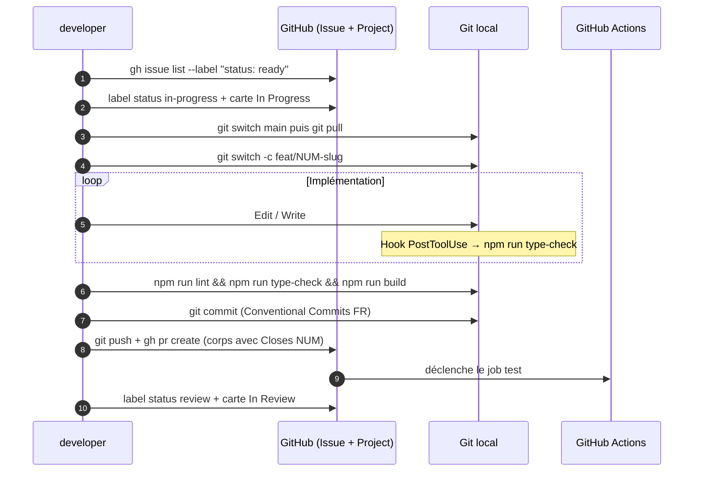

### Instructions pas à pas

1. Prendre l'issue (1re `status: ready`, p1 avant p2).
2. Passer en `status: in-progress` et déplacer la carte :
   ```bash
   gh issue edit <num> --remove-label "status: ready" --add-label "status: in-progress"
   ```
3. Créer la branche depuis `main` à jour : `feat/<num>-slug` ou `fix/<num>-slug`.
4. Implémenter **chaque** critère d'acceptation, en respectant :
   - mobile-first (base Tailwind = 375 px, puis `md:` / `lg:`) ;
   - `export default` + props typées par `interface` ;
   - `async/await` (jamais `.then()`), `<Image>` (jamais ``), pas de `any`, pas de `localStorage` ;
   - commentaires en français, identifiants en anglais ;
   - aucune nouvelle librairie sans accord humain.
5. Si un critère est ambigu : **commenter l'issue** plutôt qu'inventer.
6. Vérifier localement :
   ```bash
   npm run lint && npm run type-check && npm run build
   ```
7. Committer (`feat: …`, `fix: …`, `test: …`, `chore: …`), pousser, ouvrir la PR avec `Closes #<num>`.
8. Passer en `status: review`, carte « In Review ».

---

## 8. Phase 4 — Code review

**Responsable :** `reviewer` · **Déclencheur :** `/review-pr <num>`

### Grille de lecture

| Axe | Ce qui est vérifié |
|---|---|
| Fonctionnel | Chaque critère d'acceptation est couvert par le code |
| Constitution | Mobile-first, âges en mois, états loading/error/empty, pas de `any`, secrets côté serveur |
| Qualité | Lisibilité, pas de code mort, nommage, types partagés dans `lib/types/` |
| Performance | Pas de fetch inutile, carte en `dynamic`, images optimisées |
| Accessibilité | Labels, contrastes, cibles tactiles |
| Sécurité | RLS respectée, pas de clé en dur, pas de secret dans la PR |

### Verdict

```bash
gh pr review <num> --comment --body-file review.md
```

La dernière ligne du corps contient **exactement** l'un des deux verdicts :

```
VERDICT: APPROVED
VERDICT: CHANGES_REQUESTED
```

> ⚠️ Jamais `--approve` : le compte GitHub est le même que celui de l'auteur, GitHub refuse.
> Le verdict textuel + les labels portent l'état du workflow.

| Verdict | Label suivant | Colonne |
|---|---|---|
| `APPROVED` | `status: qa` | QA |
| `CHANGES_REQUESTED` | `status: in-progress` | In Progress (liste numérotée des changements) |

**Boucle plafonnée** : 2 allers-retours dev ↔ review (QA NO-GO compris) ; au 3e, escalade à l'humain.

---

## 9. Phase 5 — QA

**Responsable :** `qa`

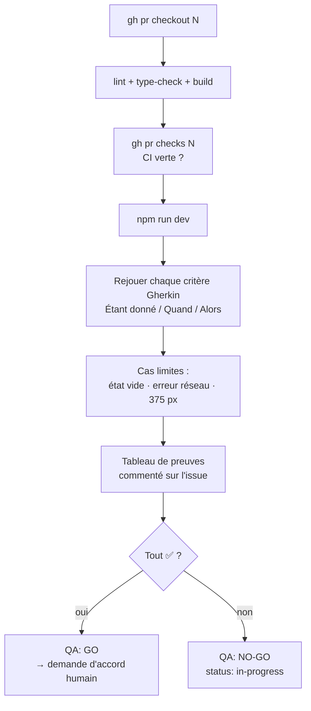

### Modèle de rapport (commentaire sur l'issue)

```markdown
## Validation QA — PR #<num>
| Critère | Résultat | Preuve |
|---|---|---|
| 1. Filtre appliqué | ✅ | 4 activités 12–24 mois affichées, 0 hors tranche |
| 2. Aucun résultat | ✅ | Message + bouton « Réinitialiser » visibles |
Checks : lint ✅ · type-check ✅ · build ✅ · CI ✅
```

> Aucun `QA: GO` si un critère n'est pas **prouvé** (test automatisé ou vérification manuelle documentée).

---

## 10. Phase 6 — Merge et déploiement

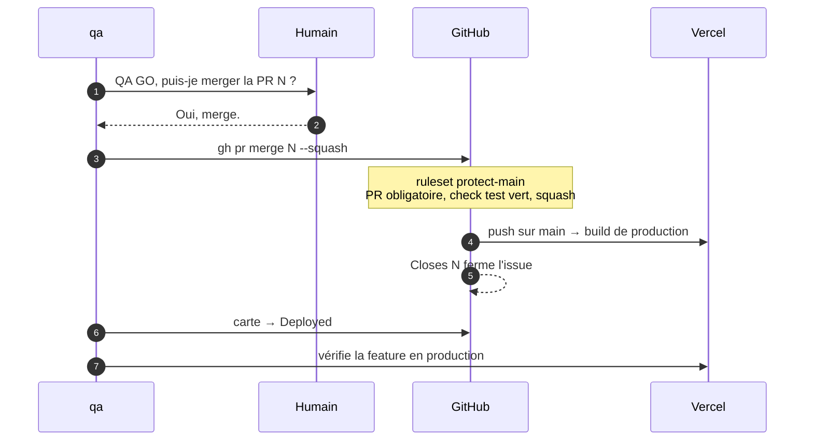

### Conditions cumulatives du merge

1. `VERDICT: APPROVED` du reviewer
2. `QA: GO` du QA
3. CI verte (job `test`)
4. **Validation humaine explicite**
5. Merge en **squash** uniquement

### Après le merge

- Supprimer la branche distante (option de `gh pr merge --delete-branch` ou via l'UI).
- Vérifier la feature sur l'URL de production Vercel.
- Revenir sur `main` en local : `git switch main && git pull`.

---

## 11. Phase 7 — Exploitation et données

La valeur de l'app dépend de la fraîcheur des données. Trois canaux d'alimentation :

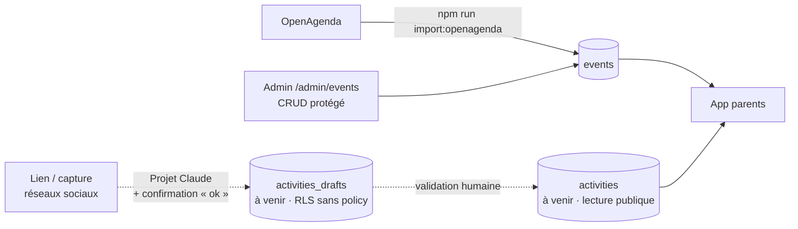

| Canal | Commande / accès | Garde-fou |
|---|---|---|
| Import OpenAgenda | `npm run import:openagenda` | Service role côté script uniquement |
| Admin CRUD | `/admin/events` | `middleware.ts` + cookie `admin_session` (`ADMIN_PASSWORD`) |
| Ingestion réseaux (spec 001, **à venir**) | Projet Claude + connecteur Supabase | Brouillons invisibles aux parents ; publication après validation |

> Les traits pointillés du schéma désignent ce qui n'est pas encore sur `main`.

### Schéma de base

Les scripts SQL sont versionnés dans `scripts/sql/` et appliqués **manuellement** dans l'éditeur SQL
Supabase. (`supabase db push` n'applique que le dossier `supabase/migrations/`, qui n'existe pas encore :
voir section 17.) Toute modification de schéma passe par une US + PR comme le reste du code.

| Table | État sur `main` | Script |
|---|---|---|
| `events` | ✅ existante | `scripts/sql/create-events-table.sql` |
| `activities` | ⏳ à venir (PR #18, US #13) | `scripts/sql/create-activities-tables.sql` |
| `activities_drafts` | ⏳ à venir (PR #18, US #13) | `scripts/sql/create-activities-tables.sql` |

### Suivi en production

- Logs de build et de runtime : tableau de bord Vercel.
- Données : tableau de bord Supabase (tables, RLS, logs API).
- Retours utilisateurs → nouvelles idées → retour en Phase 1.

---

## 12. Machine à états du board

Chaque handoff = **changement de label** `status: *` **ET** **déplacement de carte** dans le Project.

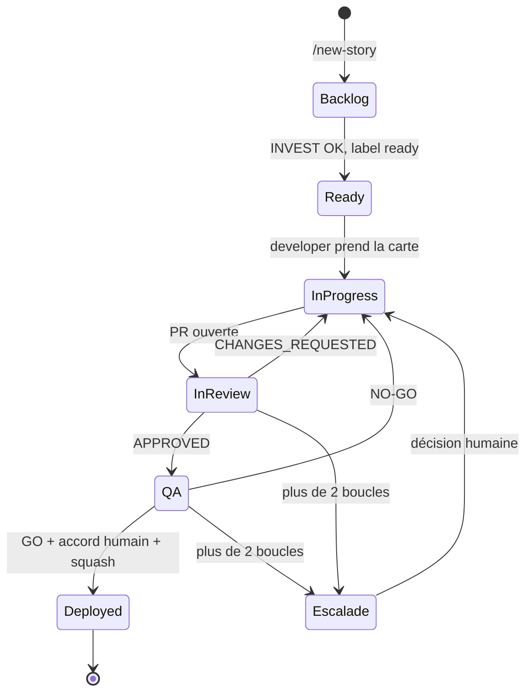

| Colonne | Label | option-id |
|---|---|---|
| Backlog | — | `58e7e7d9` |
| Ready | `status: ready` | `0031a187` |
| In Progress | `status: in-progress` | `e31e8ab5` |
| In Review | `status: review` | `ea1503a2` |
| QA | `status: qa` | `e01d3446` |
| Deployed | — (issue fermée) | `4cf0d3db` |

```bash
# Déplacer une carte
gh project item-edit --id <item-id> --project-id PVT_kwHOEgSBb84BfnM_ \
  --field-id PVTSSF_lAHOEgSBb84BfnM_zhZ43jw --single-select-option-id <option-id>
```

---

## 13. Stratégie Git

Modèle **trunk-based** : `main` est toujours déployable, branches courtes, merge squash.

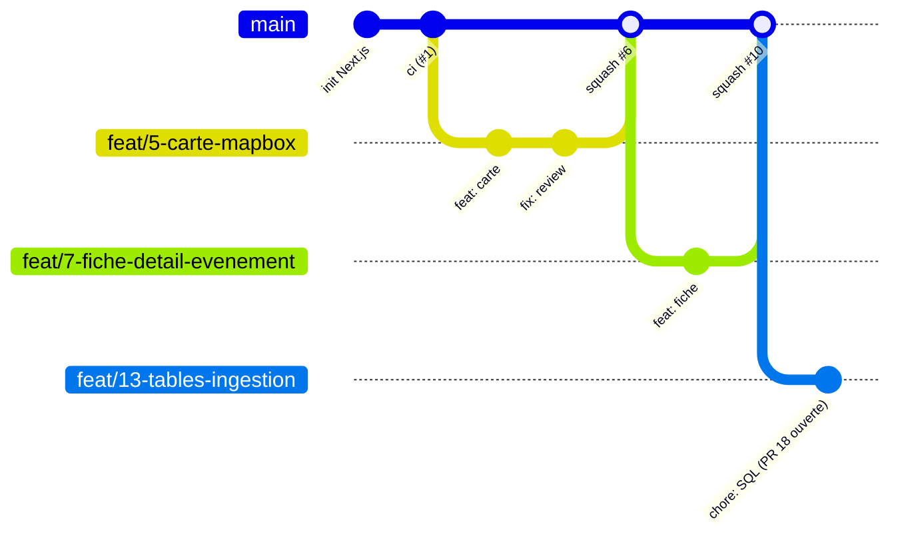

> Mermaid dessine des commits de merge ; dans le dépôt, chaque merge est en réalité un **squash**
> (un seul commit `feat: … (#N)` sur `main`). La branche `feat/13-tables-ingestion` n'est pas encore mergée.

| Élément | Convention | Exemple |
|---|---|---|
| Branche feature | `feat/<num>-slug` | `feat/13-tables-ingestion` |
| Branche correctif | `fix/<num>-slug` | `fix/21-carte-vide-safari` |
| Branche outillage | `chore/<slug>` | `chore/spec-kit` |
| Commit | Conventional Commits en français | `feat: filtre les activités par âge en mois` |
| PR | Corps avec `Closes #<num>` | — |
| Merge | Squash uniquement | Titre final : `feat: … (#N)` |

---

## 14. Portes de qualité

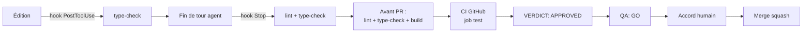

| # | Porte | Automatique ? | Bloquante ? | Où |
|---|---|---|---|---|
| 1 | Type-check à chaque édition | ✅ hook | Signal | `.claude/settings.json` |
| 2 | Lint + type-check en fin de tour | ✅ hook | Signal | `.claude/settings.json` |
| 3 | Lint + type-check + build locaux | Manuel (dev) | ✅ | Avant `gh pr create` |
| 4 | CI `test` (lint, type-check, build) | ✅ GitHub Actions | ✅ ruleset | `.github/workflows/ci.yml` |
| 5 | Review | Agent | ✅ | Commentaire PR |
| 6 | QA | Agent | ✅ | Commentaire issue + PR |
| 7 | Accord humain | — | ✅ | Chat / PR |

> Le build CI ne nécessite aucun secret : les pages qui lisent Supabase sont en `force-dynamic`, et
> `createServerClient()` comme `createPublicServerClient()` (`lib/supabase/server.ts`) renvoient
> `null` si l'environnement manque.

---

## 15. Incidents et hotfix

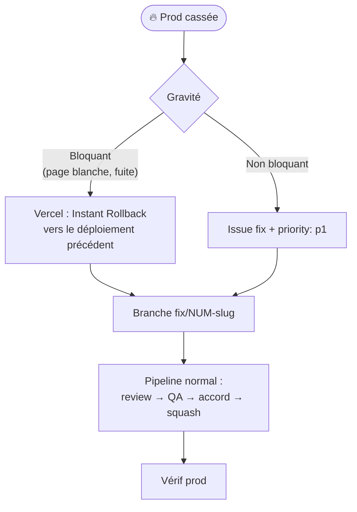

Règles :

- Le QA **signale immédiatement** à l'humain ; aucun rollback automatique par un agent.
- Un hotfix suit le même pipeline (les portes ne sautent pas, elles vont juste vite).
- **Fuite de secret** : révoquer/regénérer la clé dans Supabase/Mapbox **d'abord**, puis mettre à jour
  `.env.local` et Vercel, puis nettoyer le code. Supprimer un commit ne suffit pas.

---

## 16. Aide-mémoire des commandes

### Slash commands (Claude Code)

| Commande | Effet |
|---|---|
| `/new-story <besoin>` | Le `product-owner` crée l'issue US |
| `/pick-next [num]` | Le `developer` développe jusqu'à la PR |
| `/review-pr <num>` | Le `reviewer` poste sa review + verdict |
| `/run-sprint [num]` | Pipeline complet dev → review → QA, puis **stop** avant merge |

### Développement

```bash
npm run dev
```

```bash
npm run lint && npm run type-check && npm run build
```

```bash
npm run import:openagenda
```

### GitHub

```bash
gh issue list --label "status: ready" --json number,title,labels
```

```bash
gh pr create --title "feat: ..." --body "Closes #<num>"
```

```bash
gh pr checks <num>
```

```bash
gh pr merge <num> --squash --delete-branch
```

```bash
gh project item-list 1 --owner mehdisebei-debug --format json
```

### Variables d'environnement (`.env.local`, jamais commité)

| Variable | Portée |
|---|---|
| `NEXT_PUBLIC_SUPABASE_URL` | Client + serveur |
| `SUPABASE_URL` | Serveur, optionnelle — prioritaire sur la précédente pour `createServerClient()` |
| `NEXT_PUBLIC_SUPABASE_ANON_KEY` | Client + serveur |
| `SUPABASE_SERVICE_ROLE_KEY` | **Serveur / scripts uniquement** |
| `NEXT_PUBLIC_MAPBOX_TOKEN` | Client |
| `GOOGLE_PLACES_API_KEY` | Scripts d'import uniquement (script Google Places pas encore écrit) |
| `ADMIN_PASSWORD` | Serveur (middleware admin) — ⚠️ absente de `.env.local.example`, à y ajouter |

Modèle : `.env.local.example`.

---

## 17. Limites connues et évolutions

Écarts constatés entre la cible (`CLAUDE.md`) et l'état actuel du dépôt :

| Sujet | État actuel | Évolution prévue |
|---|---|---|
| Tests automatisés | Aucun framework ; QA manuelle documentée | Vitest (+ e2e) → bump MINOR de la constitution, QA exige un test par critère |
| Client Supabase navigateur | Seul `lib/supabase/server.ts` existe | Ajouter `lib/supabase/client.ts` à la 1re feature client authentifiée |
| State management | Zustand / TanStack Query pas encore installés | À installer avec accord humain quand les filtres seront branchés |
| Auth parents | Supabase Auth non branché (seul l'admin a un mot de passe) | US « profil + favoris » |
| Migrations | SQL versionné dans `scripts/sql/`, appliqué à la main | Passer à `supabase/migrations` + `supabase db push` |
| RPC géospatiale | `get_nearby_activities` ni définie en SQL versionné ni appelée | À créer avec la feature « autour de moi » |
| Tables `activities` / `activities_drafts` | Uniquement dans la PR #18 (US #13) | Disponibles après merge |
| Import Google Places | `scripts/import-google-places.ts` cité dans `CLAUDE.md` mais absent | US dédiée |
| Dossier `docs/` | Absent de l'arborescence de `CLAUDE.md` | L'y ajouter dans une PR `chore:` séparée |
| Previews | Pas de vérification systématique des Preview Deployments Vercel | Ajouter l'URL de preview au rapport QA |
| Mobile natif | Hors MVP | React Native + Expo après le MVP web |

---

*Dernière mise à jour : 2026-11-01 — à maintenir à chaque changement de workflow (PR `chore:`).*
