# SDLC — Kids Activity App

> Cycle de vie du développement logiciel (*Software Development Life Cycle*) du projet **kids-app** :
> de l'idée jusqu'à la production, qui fait quoi, avec quels outils et quelles règles.
>
> Documents de référence (en cas de conflit, cet ordre fait foi) :
> 1. [`.specify/memory/constitution.md`](../.specify/memory/constitution.md) — les principes non négociables
> 2. [`CLAUDE.md`](../CLAUDE.md) — conventions quotidiennes + contrat de handoff multi-agents
> 3. ce document — la vue d'ensemble et le mode d'emploi

---

## Sommaire

1. [Vue d'ensemble](#1-vue-densemble)
2. [Acteurs et outils](#2-acteurs-et-outils)
3. [Architecture cible](#3-architecture-cible)
4. [Phase 0 — Gouvernance](#4-phase-0--gouvernance)
5. [Phase 1 — Idée et cadrage](#5-phase-1--idée-et-cadrage)
6. [Phase 2 — User Story](#6-phase-2--user-story)
7. [Phase 3 — Développement](#7-phase-3--développement)
8. [Phase 4 — Code review](#8-phase-4--code-review)
9. [Phase 5 — QA](#9-phase-5--qa)
10. [Phase 6 — Merge et déploiement](#10-phase-6--merge-et-déploiement)
11. [Phase 7 — Exploitation et données](#11-phase-7--exploitation-et-données)
12. [Machine à états du board](#12-machine-à-états-du-board)
13. [Stratégie Git](#13-stratégie-git)
14. [Portes de qualité](#14-portes-de-qualité)
15. [Incidents et hotfix](#15-incidents-et-hotfix)
16. [Aide-mémoire des commandes](#16-aide-mémoire-des-commandes)
17. [Limites connues et évolutions](#17-limites-connues-et-évolutions)

---

## 1. Vue d'ensemble

Le projet suit un cycle **itératif et incrémental** : une User Story à la fois, livrée en continu
sur `main` (= production Vercel). Chaque étape est tenue par un rôle distinct et séparée de la
suivante par une **porte de qualité**.

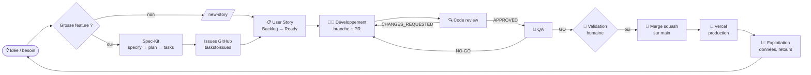

| Phase | Sortie attendue | Responsable | Porte de sortie |
|---|---|---|---|
| 0. Gouvernance | Constitution + CLAUDE.md | Humain | PR dédiée d'amendement |
| 1. Cadrage | `specs/<NNN>-*/spec.md`, `plan.md`, `tasks.md` | Humain + Spec-Kit | Gate « approve » à chaque étape |
| 2. User Story | Issue `[US]` avec Gherkin | `product-owner` | Checklist INVEST → `status: ready` |
| 3. Développement | Branche + PR `Closes #N` | `developer` | lint + type-check + build verts |
| 4. Review | Commentaire `VERDICT: *` | `reviewer` | `VERDICT: APPROVED` |
| 5. QA | Tableau de preuves sur l'issue | `qa` | `QA: GO` + CI verte |
| 6. Merge | Commit squash sur `main` | **Humain** | Accord explicite |
| 7. Exploitation | Prod Vercel, données Supabase | Humain | Vérification prod |

---

## 2. Acteurs et outils

### 2.1 Rôles

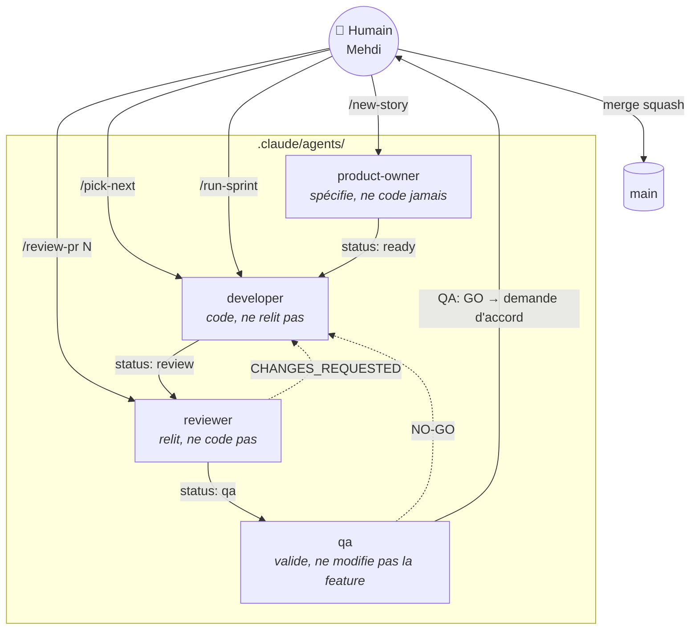

| Acteur | Fichier de définition | Skill chargée | Peut | Ne peut pas |
|---|---|---|---|---|
| Humain | — | — | Tout décider, **seul à autoriser un merge** | — |
| `product-owner` | `.claude/agents/product-owner.md` | `writing-user-stories` | Créer/affiner des issues | Coder |
| `developer` | `.claude/agents/developer.md` | `feature-development` | Brancher, coder, ouvrir une PR | Merger, relire son code |
| `reviewer` | `.claude/agents/reviewer.md` | `code-review` | Commenter la PR, poser un verdict | Modifier le code |
| `qa` | `.claude/agents/qa.md` | `testing` | Tester, écrire des tests, `QA: GO/NO-GO` | Modifier la feature, merger seul |

### 2.2 Outils

| Besoin | Outil |
|---|---|
| Code | Next.js 14 (App Router) · TypeScript · Tailwind CSS |
| Données | Supabase (PostgreSQL + PostGIS, RLS, Auth) |
| Carte | Mapbox GL JS via `react-map-gl` |
| Suivi | GitHub Issues + Project **KIDS-APP Pipeline** (n° 1) |
| Spécification | GitHub Spec-Kit (`.specify/`, skills `speckit-*`) |
| CI | GitHub Actions (`.github/workflows/ci.yml`, job `test`) |
| Protection | Ruleset GitHub `protect-main` (PR obligatoire, squash, check `test` requis) |
| Hébergement | Vercel (`main` = production automatique) |
| Agents | Claude Code (sous-agents, slash commands, hooks) |

---

## 3. Architecture cible

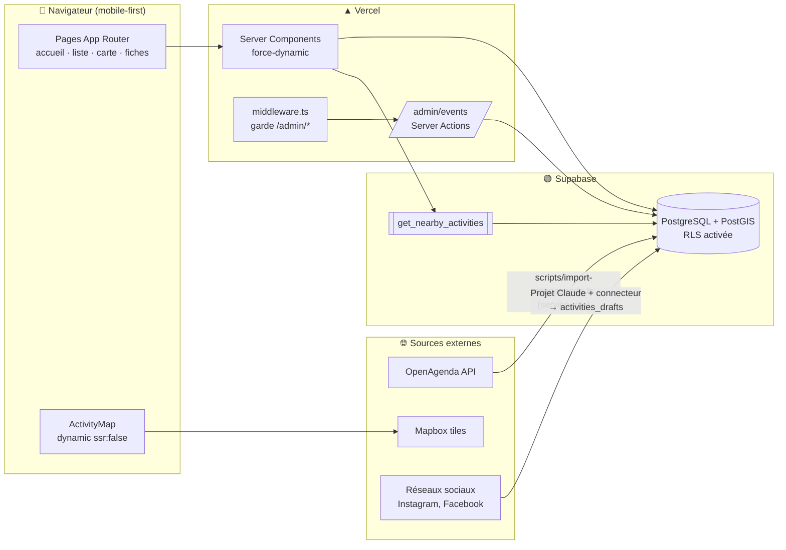

Règles d'architecture qui découlent de la constitution :

- **Secrets** : `SUPABASE_SERVICE_ROLE_KEY` uniquement dans `scripts/` et le code serveur, jamais dans
  un composant client. Tout est dans `.env.local` (local) et les variables d'environnement Vercel (prod).
- **Âges** : stockés en **mois** en base, convertis en années uniquement à l'affichage.
- **Carte** : toujours `dynamic(() => import(...), { ssr: false })` (Mapbox utilise `window`).
- **États** : tout composant qui fetch gère `loading`, `error`, `empty`.

---

## 4. Phase 0 — Gouvernance

La gouvernance définit les règles du jeu **avant** d'écrire du code.

| Document | Rôle | Comment le modifier |
|---|---|---|
| `constitution.md` | 5 principes (mobile-first, âge en mois, états explicites, typage strict, secrets) | PR dédiée + bump de version sémantique (skill `speckit-constitution`) |
| `CLAUDE.md` | Conventions, stack, contrat de handoff, IDs du Project | PR `chore:` |
| `.claude/agents/*.md` | Périmètre de chaque agent | PR `chore:` |
| `.claude/skills/*/SKILL.md` | Méthode détaillée de chaque rôle | PR `chore:` |
| `.claude/settings.json` | Hooks automatiques (type-check après chaque édition, lint + type-check en fin de tour) | PR `chore:` |

**Versionnage de la constitution :**

| Bump | Quand |
|---|---|
| MAJOR | Retrait ou redéfinition incompatible d'un principe |
| MINOR | Ajout d'un principe/section (ex. : arrivée de Vitest) |
| PATCH | Reformulation sans effet sémantique |

> ⚠️ Un amendement ne se glisse **jamais** dans une PR de fonctionnalité.

---

## 5. Phase 1 — Idée et cadrage

Deux chemins selon la taille du besoin :

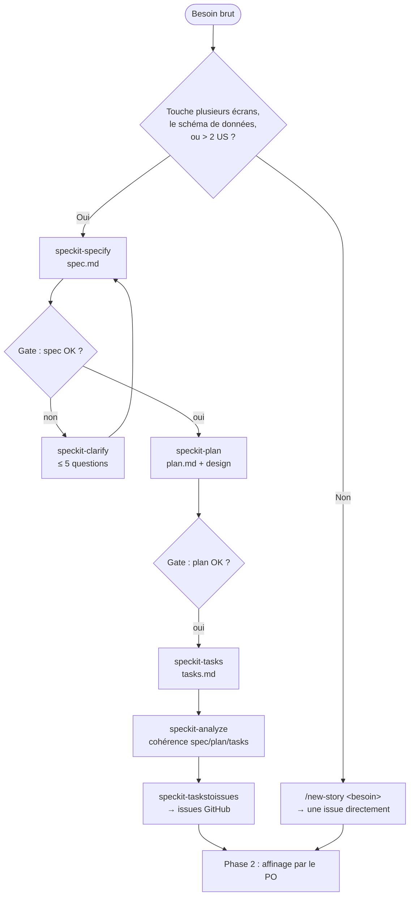

### Instructions — chemin Spec-Kit

1. Décrire le besoin en langage naturel et lancer la skill `speckit-specify`.
   → crée `specs/<NNN>-<slug>/spec.md` et met à jour `.specify/feature.json`.
2. Relire la spec. Si des zones sont floues : `speckit-clarify`.
3. `speckit-plan` → `plan.md` (choix techniques confrontés à la constitution).
4. `speckit-tasks` → `tasks.md` ordonné par dépendances.
5. `speckit-analyze` → rapport de cohérence (non destructif).
6. `speckit-taskstoissues` → une issue par tâche/US, ensuite affinées par le `product-owner`.
7. Plus tard, `speckit-converge` compare le code au plan et ajoute les tâches manquantes.

> Exemple en cours : `specs/001-ingestion-sans-code/` (ingestion d'activités en brouillon depuis les
> réseaux sociaux, validation humaine avant publication).

---

## 6. Phase 2 — User Story

**Responsable :** `product-owner` · **Déclencheur :** `/new-story <besoin>`

### Format obligatoire

```markdown
## User Story
- **En tant que** parent d'un enfant de 18 mois
- **Je veux** filtrer les activités par âge
- **Afin de** ne voir que ce qui convient à mon enfant

## Critères d'acceptation

### Critère 1 : filtre appliqué
Étant donné la liste des activités
Quand je choisis « 1–2 ans »
Alors seules les activités dont la tranche couvre 12–24 mois s'affichent

### Critère 2 : aucun résultat
Étant donné un filtre sans correspondance
Quand la liste se recharge
Alors un message « Aucune activité » avec un bouton « Réinitialiser » s'affiche
```

### Règles

- Titre préfixé `[US]`, verbe d'action.
- 2 à 5 critères Gherkin ; chaque « Alors » est **observable dans l'UI**.
- Toujours un critère pour l'état vide ou d'erreur si la feature fetch des données.
- Une US = moins de 1–2 jours de dev à temps partiel ; sinon, découper.

### Checklist INVEST (avant `Ready`)

- [ ] **I**ndependent · [ ] **N**egotiable · [ ] **V**aluable · [ ] **E**stimable · [ ] **S**mall · [ ] **T**estable

### Labels

| Label | Valeurs |
|---|---|
| Type | `type: user-story` (toujours) |
| Zone | `area: age-filter` · `area: map` · `area: admin` |
| Priorité | `priority: p1` (bloquant MVP) · `priority: p2` |
| Statut | `status: ready` → `in-progress` → `review` → `qa` |

### Commandes

```bash
gh issue create --title "[US] ..." --body-file us.md --label "type: user-story" --label "priority: p1"
```

```bash
gh project item-add 1 --owner mehdisebei-debug --url <url-issue>
```

---

## 7. Phase 3 — Développement

**Responsable :** `developer` · **Déclencheur :** `/pick-next [num]`

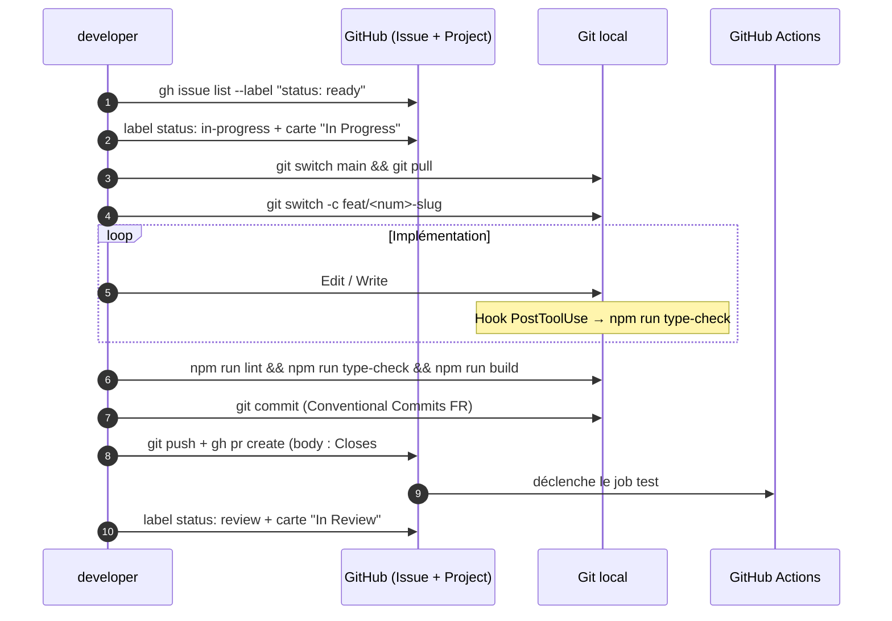

### Instructions pas à pas

1. Prendre l'issue (1re `status: ready`, p1 avant p2).
2. Passer en `status: in-progress` et déplacer la carte :
   ```bash
   gh issue edit <num> --remove-label "status: ready" --add-label "status: in-progress"
   ```
3. Créer la branche depuis `main` à jour : `feat/<num>-slug` ou `fix/<num>-slug`.
4. Implémenter **chaque** critère d'acceptation, en respectant :
   - mobile-first (base Tailwind = 375 px, puis `md:` / `lg:`) ;
   - `export default` + props typées par `interface` ;
   - `async/await` (jamais `.then()`), `<Image>` (jamais ``), pas de `any`, pas de `localStorage` ;
   - commentaires en français, identifiants en anglais ;
   - aucune nouvelle librairie sans accord humain.
5. Si un critère est ambigu : **commenter l'issue** plutôt qu'inventer.
6. Vérifier localement :
   ```bash
   npm run lint && npm run type-check && npm run build
   ```
7. Committer (`feat: …`, `fix: …`, `test: …`, `chore: …`), pousser, ouvrir la PR avec `Closes #<num>`.
8. Passer en `status: review`, carte « In Review ».

---

## 8. Phase 4 — Code review

**Responsable :** `reviewer` · **Déclencheur :** `/review-pr <num>`

### Grille de lecture

| Axe | Ce qui est vérifié |
|---|---|
| Fonctionnel | Chaque critère d'acceptation est couvert par le code |
| Constitution | Mobile-first, âges en mois, états loading/error/empty, pas de `any`, secrets côté serveur |
| Qualité | Lisibilité, pas de code mort, nommage, types partagés dans `lib/types/` |
| Performance | Pas de fetch inutile, carte en `dynamic`, images optimisées |
| Accessibilité | Labels, contrastes, cibles tactiles |
| Sécurité | RLS respectée, pas de clé en dur, pas de secret dans la PR |

### Verdict

```bash
gh pr review <num> --comment --body-file review.md
```

La dernière ligne du corps contient **exactement** l'un des deux verdicts :

```
VERDICT: APPROVED
VERDICT: CHANGES_REQUESTED
```

> ⚠️ Jamais `--approve` : le compte GitHub est le même que celui de l'auteur, GitHub refuse.
> Le verdict textuel + les labels portent l'état du workflow.

| Verdict | Label suivant | Colonne |
|---|---|---|
| `APPROVED` | `status: qa` | QA |
| `CHANGES_REQUESTED` | `status: in-progress` | In Progress (liste numérotée des changements) |

**Boucle plafonnée** : 2 allers-retours dev ↔ review (QA NO-GO compris) ; au 3e, escalade à l'humain.

---

## 9. Phase 5 — QA

**Responsable :** `qa`

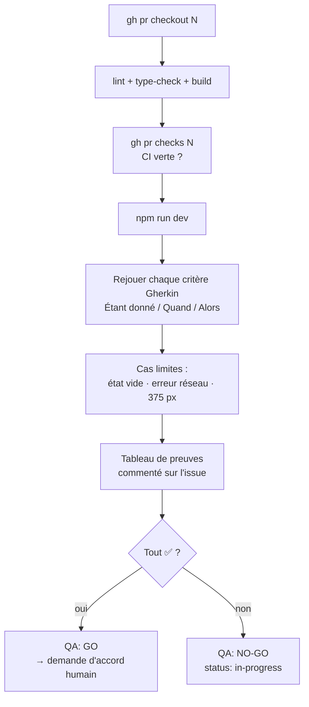

### Modèle de rapport (commentaire sur l'issue)

```markdown
## Validation QA — PR #<num>
| Critère | Résultat | Preuve |
|---|---|---|
| 1. Filtre appliqué | ✅ | 4 activités 12–24 mois affichées, 0 hors tranche |
| 2. Aucun résultat | ✅ | Message + bouton « Réinitialiser » visibles |
Checks : lint ✅ · type-check ✅ · build ✅ · CI ✅
```

> Aucun `QA: GO` si un critère n'est pas **prouvé** (test automatisé ou vérification manuelle documentée).

---

## 10. Phase 6 — Merge et déploiement

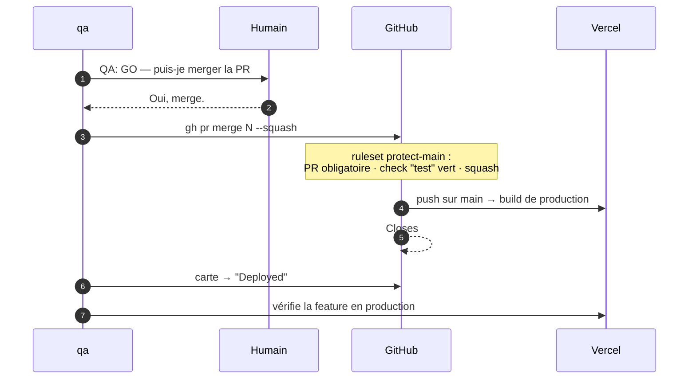

### Conditions cumulatives du merge

1. `VERDICT: APPROVED` du reviewer
2. `QA: GO` du QA
3. CI verte (job `test`)
4. **Validation humaine explicite**
5. Merge en **squash** uniquement

### Après le merge

- Supprimer la branche distante (option de `gh pr merge --delete-branch` ou via l'UI).
- Vérifier la feature sur l'URL de production Vercel.
- Revenir sur `main` en local : `git switch main && git pull`.

---

## 11. Phase 7 — Exploitation et données

La valeur de l'app dépend de la fraîcheur des données. Trois canaux d'alimentation :

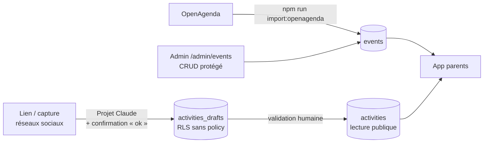

| Canal | Commande / accès | Garde-fou |
|---|---|---|
| Import OpenAgenda | `npm run import:openagenda` | Service role côté script uniquement |
| Admin CRUD | `/admin/events` | `middleware.ts` + cookie `admin_session` (`ADMIN_PASSWORD`) |
| Ingestion réseaux (spec 001) | Projet Claude + connecteur Supabase | Brouillons invisibles aux parents ; publication après validation |

### Schéma de base

Les scripts SQL sont versionnés dans `scripts/sql/` et appliqués manuellement dans l'éditeur SQL
Supabase (ou via `supabase db push` si la CLI est installée). Toute modification de schéma passe par
une US + PR comme le reste du code.

### Suivi en production

- Logs de build et de runtime : tableau de bord Vercel.
- Données : tableau de bord Supabase (tables, RLS, logs API).
- Retours utilisateurs → nouvelles idées → retour en Phase 1.

---

## 12. Machine à états du board

Chaque handoff = **changement de label** `status: *` **ET** **déplacement de carte** dans le Project.

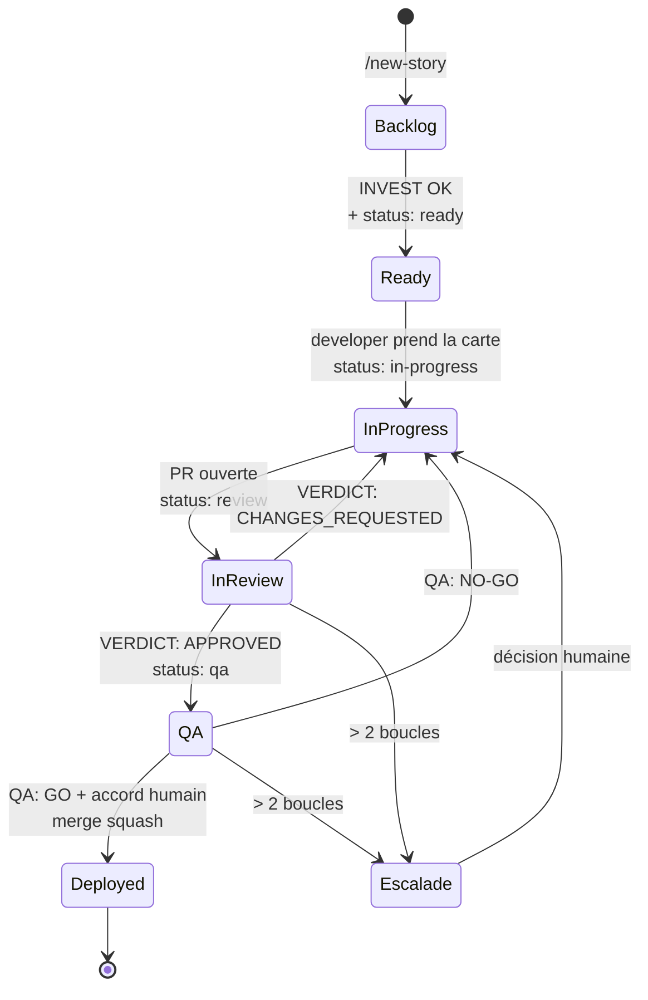

| Colonne | Label | option-id |
|---|---|---|
| Backlog | — | `58e7e7d9` |
| Ready | `status: ready` | `0031a187` |
| In Progress | `status: in-progress` | `e31e8ab5` |
| In Review | `status: review` | `ea1503a2` |
| QA | `status: qa` | `e01d3446` |
| Deployed | — (issue fermée) | `4cf0d3db` |

```bash
# Déplacer une carte
gh project item-edit --id <item-id> --project-id PVT_kwHOEgSBb84BfnM_ \
  --field-id PVTSSF_lAHOEgSBb84BfnM_zhZ43jw --single-select-option-id <option-id>
```

---

## 13. Stratégie Git

Modèle **trunk-based** : `main` est toujours déployable, branches courtes, merge squash.

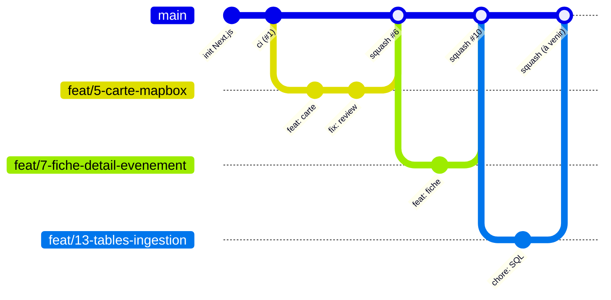

| Élément | Convention | Exemple |
|---|---|---|
| Branche feature | `feat/<num>-slug` | `feat/13-tables-ingestion` |
| Branche correctif | `fix/<num>-slug` | `fix/21-carte-vide-safari` |
| Branche outillage | `chore/<slug>` | `chore/spec-kit` |
| Commit | Conventional Commits en français | `feat: filtre les activités par âge en mois` |
| PR | Corps avec `Closes #<num>` | — |
| Merge | Squash uniquement | Titre final : `feat: … (#N)` |

---

## 14. Portes de qualité

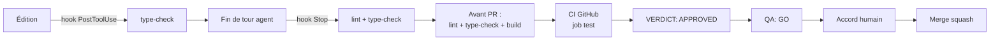

| # | Porte | Automatique ? | Bloquante ? | Où |
|---|---|---|---|---|
| 1 | Type-check à chaque édition | ✅ hook | Signal | `.claude/settings.json` |
| 2 | Lint + type-check en fin de tour | ✅ hook | Signal | `.claude/settings.json` |
| 3 | Lint + type-check + build locaux | Manuel (dev) | ✅ | Avant `gh pr create` |
| 4 | CI `test` (lint, type-check, build) | ✅ GitHub Actions | ✅ ruleset | `.github/workflows/ci.yml` |
| 5 | Review | Agent | ✅ | Commentaire PR |
| 6 | QA | Agent | ✅ | Commentaire issue + PR |
| 7 | Accord humain | — | ✅ | Chat / PR |

> Le build CI ne nécessite aucun secret : les pages qui lisent Supabase sont en `force-dynamic` et
> `createServerClient()` renvoie `null` si l'environnement manque.

---

## 15. Incidents et hotfix

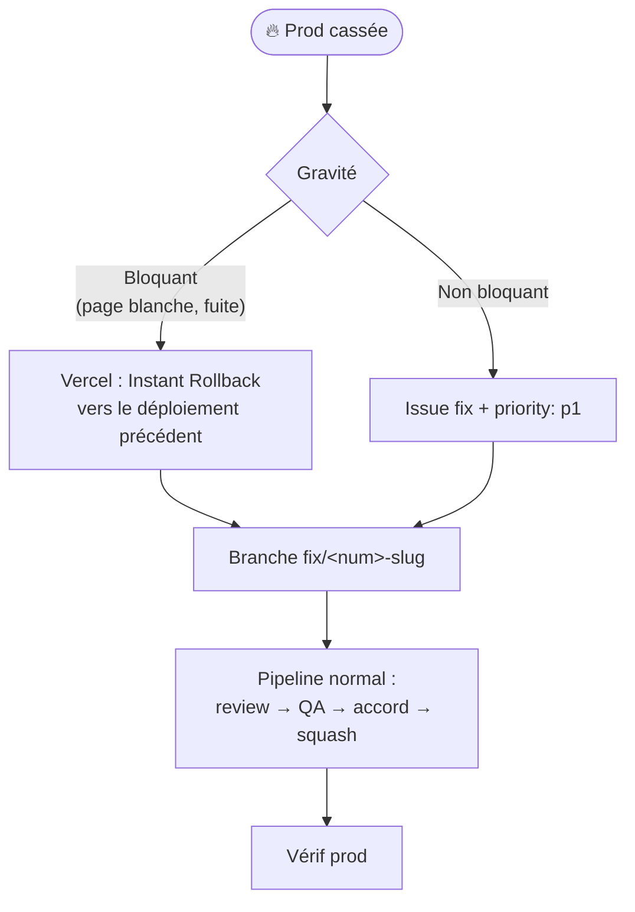

Règles :

- Le QA **signale immédiatement** à l'humain ; aucun rollback automatique par un agent.
- Un hotfix suit le même pipeline (les portes ne sautent pas, elles vont juste vite).
- **Fuite de secret** : révoquer/regénérer la clé dans Supabase/Mapbox **d'abord**, puis mettre à jour
  `.env.local` et Vercel, puis nettoyer le code. Supprimer un commit ne suffit pas.

---

## 16. Aide-mémoire des commandes

### Slash commands (Claude Code)

| Commande | Effet |
|---|---|
| `/new-story <besoin>` | Le `product-owner` crée l'issue US |
| `/pick-next [num]` | Le `developer` développe jusqu'à la PR |
| `/review-pr <num>` | Le `reviewer` poste sa review + verdict |
| `/run-sprint [num]` | Pipeline complet dev → review → QA, puis **stop** avant merge |

### Développement

```bash
npm run dev
```

```bash
npm run lint && npm run type-check && npm run build
```

```bash
npm run import:openagenda
```

### GitHub

```bash
gh issue list --label "status: ready" --json number,title,labels
```

```bash
gh pr create --title "feat: ..." --body "Closes #<num>"
```

```bash
gh pr checks <num>
```

```bash
gh pr merge <num> --squash --delete-branch
```

```bash
gh project item-list 1 --owner mehdisebei-debug --format json
```

### Variables d'environnement (`.env.local`, jamais commité)

| Variable | Portée |
|---|---|
| `NEXT_PUBLIC_SUPABASE_URL` | Client + serveur |
| `NEXT_PUBLIC_SUPABASE_ANON_KEY` | Client + serveur |
| `SUPABASE_SERVICE_ROLE_KEY` | **Serveur / scripts uniquement** |
| `NEXT_PUBLIC_MAPBOX_TOKEN` | Client |
| `GOOGLE_PLACES_API_KEY` | Scripts d'import uniquement |
| `ADMIN_PASSWORD` | Serveur (middleware admin) — ⚠️ absente de `.env.local.example`, à y ajouter |

Modèle : `.env.local.example`.

---

## 17. Limites connues et évolutions

Écarts constatés entre la cible (`CLAUDE.md`) et l'état actuel du dépôt :

| Sujet | État actuel | Évolution prévue |
|---|---|---|
| Tests automatisés | Aucun framework ; QA manuelle documentée | Vitest (+ e2e) → bump MINOR de la constitution, QA exige un test par critère |
| Client Supabase navigateur | Seul `lib/supabase/server.ts` existe | Ajouter `lib/supabase/client.ts` à la 1re feature client authentifiée |
| State management | Zustand / TanStack Query pas encore installés | À installer avec accord humain quand les filtres seront branchés |
| Auth parents | Supabase Auth non branché (seul l'admin a un mot de passe) | US « profil + favoris » |
| Migrations | SQL versionné dans `scripts/sql/`, appliqué à la main | Passer à `supabase/migrations` + `supabase db push` |
| Previews | Pas de vérification systématique des Preview Deployments Vercel | Ajouter l'URL de preview au rapport QA |
| Mobile natif | Hors MVP | React Native + Expo après le MVP web |

---

*Dernière mise à jour : 2026-11-01 — à maintenir à chaque changement de workflow (PR `chore:`).*
